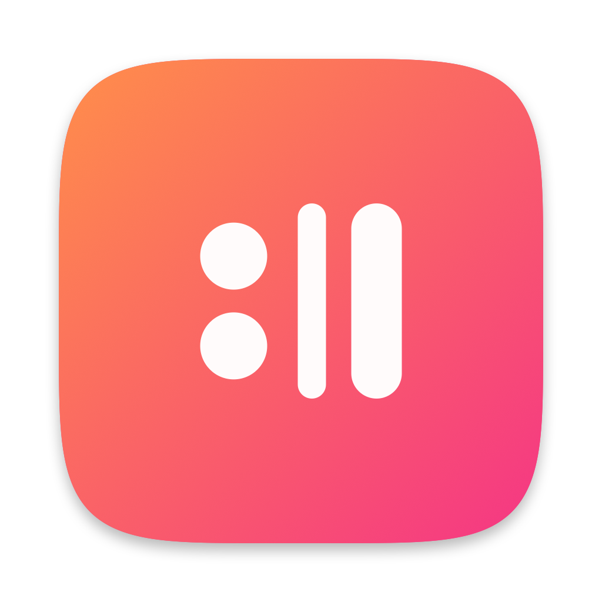
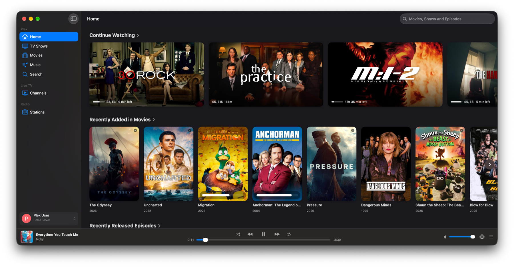
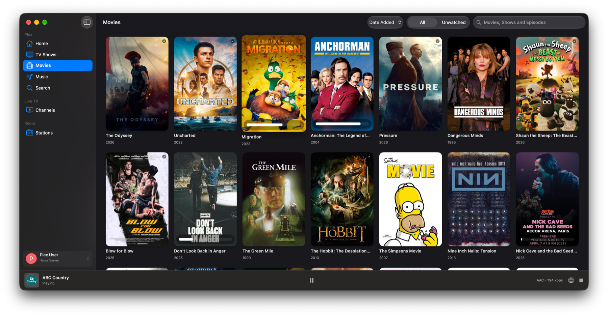
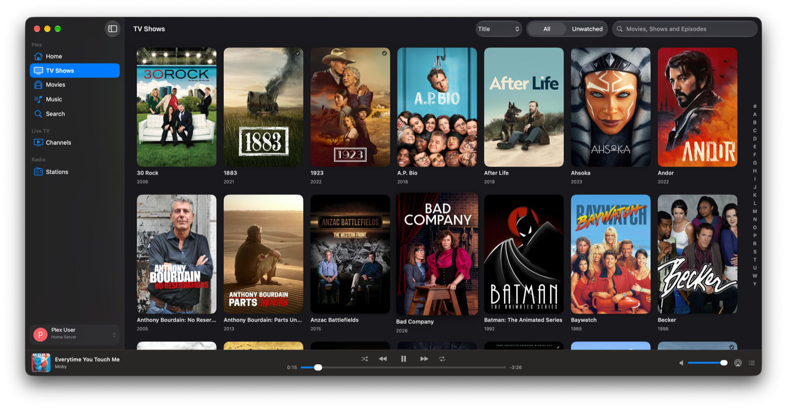
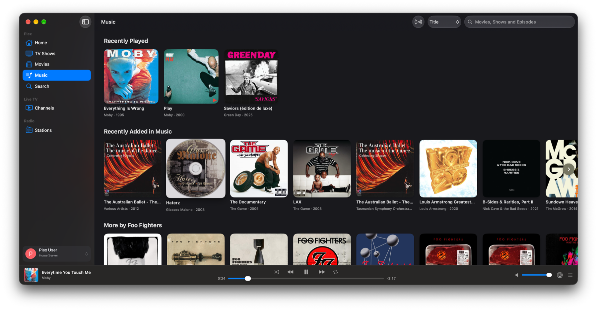
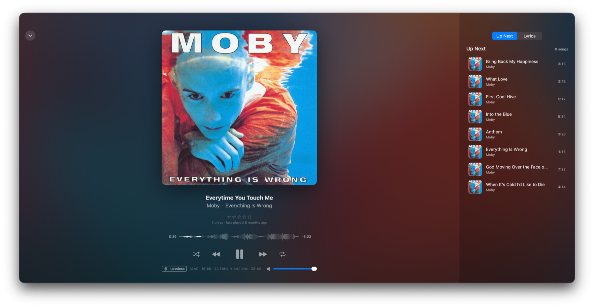
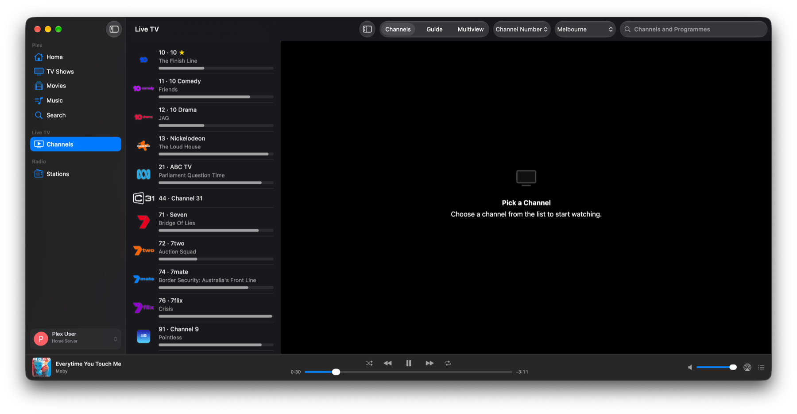
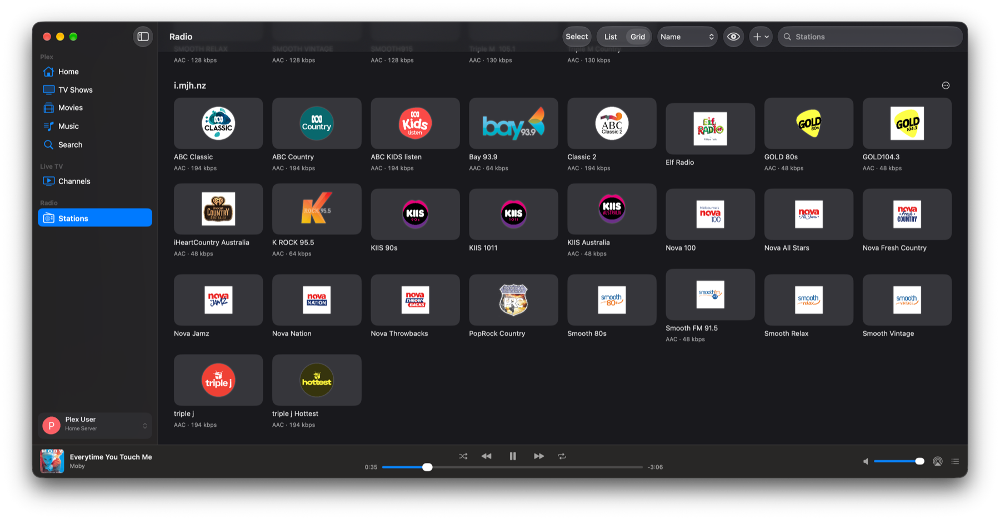

# Reprise for Mac

**Plex, music and Live TV on your Mac.**

  

## About

Reprise for Mac is a native media client for Plex and Live TV, built for Apple
silicon Macs running macOS 27 or later. It brings together Plex video and music,
Live TV from Plex or IPTV sources, and a Mac-native interface with a sidebar, menus,
keyboard shortcuts, and full-screen playback.

This app is a Mac port of [Rivulet](https://github.com/l984-451/Rivulet), the
tvOS app by Bain Gurley. Plex features require access to a Plex account and
server; IPTV sources can be configured separately.

## Features

- **Plex**: sign in, choose a server and Home profile, browse Home, your movie
  and TV libraries and search. Play with resume, progress sync, Skip Intro and
  Credits, Up Next, and Home or Away streaming quality. Info, Chapters and
  Details panes open above the player controls. AirPlay for transcoded video.
- **Music**: browse Plex music libraries, play albums and artists with gapless
  albums, loudness levelling and optional crossfade, and a queue that is still there
  after you quit. Rate what you hear, and see what you play most. Download Ahead saves the
  next tracks on your Mac, within a size limit you set. Optional online artist
  and album details (off by default) add bios, photos and links.
- **Radio**: internet radio stations and playlists, showing the song a station
  sends and its quality.
- **Live TV**: M3U playlists with XMLTV guides, Dispatcharr servers, and your
  Plex server's tuners. A guide with what's on now, favourites and recently
  watched. Pop the picture out into a floating window, or watch up to four
  channels at once in multiview.
- **Playback**: [AetherEngine](https://github.com/superuser404notfound/AetherEngine)
  plays files directly, including MKV, HDR10, Dolby Vision and Atmos, with a Plex
  transcode as the fallback. Captions follow your Mac's caption settings.
- **Siri, Spotlight and Shortcuts**: play titles, channels and stations by voice
  or from Shortcuts. Continue Watching and favourite channels appear in Spotlight.
- **Smart search**: with Apple Intelligence on, a search of three or more words,
  such as "unwatched comedies under 90 minutes", is read into Plex filters beside
  the normal keyword results.
- **Menu bar player** (optional): a mini player in the menu bar that keeps music
  and radio playing with the window closed.
- **Updates**: the app updates itself from GitHub releases.

## Screenshots

<table>
  <tr>
    <td width="50%"> Movies</td>
    <td width="50%"> TV Shows</td>
  </tr>
  <tr>
    <td> Music</td>
    <td> Now Playing</td>
  </tr>
  <tr>
    <td> Live TV</td>
    <td> Radio</td>
  </tr>
</table>

## Keyboard

| Key | Action |
| --- | --- |
| Space | Play or pause |
| ← / → | Skip back or forward (Plex; lengths are set in Settings > Video) |
| Esc | Close the player |
| ↑ / ↓ in the channel list | Change channel |
| ⌥⌘← / ⌥⌘→ | Skip back or forward |
| ⌥⌘↑ / ⌥⌘↓ | Previous or next channel |
| ⇧⌘M | Mute or unmute |
| ⇧⌘L | Go live |
| ⌘D | Add or remove the channel from favourites |
| ⌘. | Stop |
| ⌃⌘F or double-click | Full screen |
| ⌃⌘P | Picture in Picture (Plex) |
| ⌘R | Refresh |
| ⌘, | Settings |

## Build

You need a Mac with Apple silicon running macOS 27 or later, and Xcode.

1. Clone the repo and open `Rivulet.xcodeproj`.
2. Choose the **Rivulet Mac** scheme, then in the target's Signing & Capabilities set your own team (a free Apple ID Personal Team works), and press Run.

## Licence

[PolyForm Noncommercial 1.0.0](LICENSE). Free for personal, noncommercial use;
not for sale.

Required Notice: Copyright (C) 2025-2026 Bain Gurley
